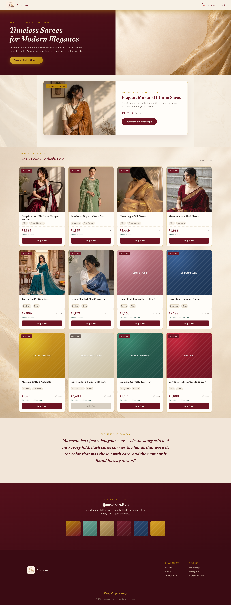

# Aavaran

**Every drape, a story.**

Sellers who sell sarees over Facebook Live usually take orders by screenshot: buyers capture the stream and message the seller on WhatsApp with their address. It works, but it's messy Aavaran gives these sellers a proper catalogue instead. Buyers browse, tap **Buy Now**, and WhatsApp opens with the order already written out. The seller only has to collect payment.

Aavaran is a working demo of that idea, with its own brand, logo, colour theme and product catalogue.

**Live demo:** https://aavaran-sigma.vercel.app/

---

## Features

**For buyers**
- Hero section and a featured piece from the day's live sale
- Product grid, newest first, with photo, name, fabric and colour tags, price and a product code (for example `AV-117`)
- "In stock" and "Sold out" badges, plus how recently each item was added
- **Buy Now** opens a short form (name, delivery address, optional size or notes) and then opens WhatsApp with the order message prefilled
- Brand story section and links to the seller's live channels
- Responsive layout for phone and desktop

**For the seller**
- A private admin page, reached by a secret link with no login. The seller picks a photo and types the name, price and category.
- Image hosting, product-code generation and adding the product to the catalogue all happen automatically, so there are no links to copy by hand
- Stock lives in a Google Sheet that looks like Excel. To mark something sold out, the seller edits the sheet.

## Tech stack

| Area | Technology |
| --- | --- |
| Front end | HTML, CSS, JavaScript |
| Product database | Google Sheets |
| Image hosting | Cloudinary |
| Ordering | WhatsApp click-to-chat with a prefilled message |
| Hosting | Vercel |

## How it works

1. The seller opens the admin link, picks a photo and fills in the name, price and category.
2. The photo is uploaded to Cloudinary, a product code is generated, and a new row is added to the Google Sheet.
3. The storefront reads the sheet and shows the newest products first.
4. A buyer taps **Buy Now**, fills in the form, and WhatsApp opens with the buyer's details and the product code already in the message.
5. The seller confirms the order in WhatsApp and collects payment.

## Design

A maroon-and-gold palette with a serif display style, chosen to feel like a boutique rather than a generic marketplace. The brand name, logo, copy and product photography were designed together so the demo reads as a real store.

## Design decisions

- **Google Sheets as the database.** The sellers already know spreadsheets, and they don't hold bulk stock, so marking an item sold out is a one-cell edit.
- **WhatsApp for checkout.** The buyers and sellers already talk on WhatsApp, so the order message replaces the screenshot instead of adding a new tool.
- **No payments built in.** The seller collects payment over WhatsApp, which keeps the demo simple and matches how these sellers work today.

## Limitations

- The admin page uses a private link instead of a login. That keeps it simple for a demo, but anyone with the link can add products, so a real launch would add authentication.
- One product per order, with no cart.
- There are no online payments.

## To run your own copy

You need a Google Sheet for the products, a Cloudinary account for the images, and a WhatsApp number to receive orders.

---

Built by Umang.
